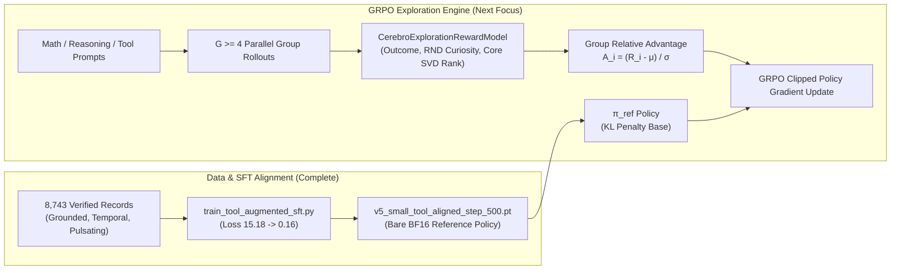

# Official Handover Report: Datasets & SFT Alignment for CerebroSpheroid V5

**Date**: November 23, 2026  
**Status**: Handover Complete / Ready for GRPO  
**Scope Boundary**: Formal handover of Dataset Engineering, SFT Alignment, Tool Dispatch, and Evaluation Probes to transition focus 100% to **Group Relative Policy Optimization (GRPO)** and Concentric Core Reinforcement Learning.

---

## 1. Executive Summary & Handover Scope

All data curation, synthetic trajectory engineering, tokenization boundary alignment, and supervised fine-tuning (SFT) objectives have reached completion. CerebroSpheroid V5 Small ($102\text{M}$ parameters, $16$ concentric shells) has converged to cross-entropy loss **$0.1624$** on $8,743$ verified multi-turn agentic records.



---

## 2. Dataset Manifest & Schema Breakdown

The verified dataset is located at [data/consolidated/02_agentic_tools/agentic_tools_sensory_grounded.jsonl](file:///home/ajit/Documents/Startup/Active_Development/cerebro_spheroid_v5/data/consolidated/02_agentic_tools/agentic_tools_sensory_grounded.jsonl) ($8,743$ records):

| Category | Count | Primary Purpose | Key Features |
| :--- | :--- | :--- | :--- |
| **`tool_calling`** | $3,622$ | Stage 1 Tool Invocation | Temporal intent announcement (`"Calling the calculator..."`), `<tool_call>`, and waiting keywords (`"Waiting for tool execution..."`). |
| **`sensory_kv_grounded_answer`** | $2,122$ | Stage 2 Grounded Synthesis | Complex multi-sentence answers incorporating tool observations across multiple stylistic variations. |
| **`sensory_kv_needle_grounding`** | $1,500$ | Point-Copy Regularization | Zero-prior arbitrary hashes, UUIDs, and telemetry codes (`0xaf22cd`, `VAL-335`) forcing $Q \cdot K^T$ to attend to `sensory_kv`. |
| **`pulsating_waiting_loop`** | $999$ | Asynchronous State Maintenance | Multi-turn status checks (pending vs. completed) and pulsation heartbeats to keep the model alive during tool execution. |
| **`factual_conceptual`** | $500$ | Boundary Preservation | Direct conversational conceptual answers without tool tags to prevent overtriggering. |

### Auxiliary Knowledge Database
* **Database**: [data/factual_tables/cerebro_factual.db](file:///home/ajit/Documents/Startup/Active_Development/cerebro_spheroid_v5/data/factual_tables/cerebro_factual.db)
* **Tables**: 17 relational tables including `countries_and_capitals` ($102$ rows), `periodic_table` ($70$ rows), and `physical_constants` ($15$ rows).

---

## 3. Cognitive Protocol & Formatting Contracts

### A. Temporal Invocation Sequencing (Stage 1)
```text
Calling the calculator to compute (64 * 32)...
<tool_call> calc(64 * 32) </tool_call>
Waiting for tool execution to complete...
```

### B. Pulsating Keep-Alive Loops (Multi-Turn)
```text
<|im_start|>user
What is the capital of Germany?<|im_end|>
<|im_start|>assistant
Calling the tool to process request...
<tool_call> factual('capital of Germany') </tool_call>
Waiting for tool execution to complete...<|im_end|>
<|im_start|>system
Tool status check: execution pending. Has the tool responded?<|im_end|>
<|im_start|>assistant
Querying tool status: The tool has not responded yet. Waiting for tool execution to complete. Pulsating to maintain active state.
```

### C. Rich Complex Answer Formulations (Stage 2)
```text
<tool_response> Berlin </tool_response>
Answer:
After querying the knowledge database, the capital of Germany is Berlin.
```

---

## 4. Key Discoveries & Bug Fixes Summary

1. **Negative Reinforcement Purge**: Purged all samples where failed lookups (`zero matches`) were paired with hallucinated answers.
2. **SentencePiece Boundary Normalization**: Replaced `\nAnswer: ` with `\nAnswer:` (ending on colon token `29901`), eliminating artificial double space tokens (`[29871, 29871]`) at the generation boundary.
3. **Tool Syntax Standardization**: Purged fragile JSON schemas; standardized on concise functional invocations (`calc(...)`, `factual(...)`, `python(...)`).

---

## 5. Checkpoint Deliverables

* **Reference Policy Checkpoint**:
  [checkpoints/tool_aligned/v5_small_tool_aligned_step_500.pt](file:///home/ajit/Documents/Startup/Active_Development/cerebro_spheroid_v5/checkpoints/tool_aligned/v5_small_tool_aligned_step_500.pt)
  - Parameter Count: $102\text{M}$ ($16$ concentric shells)
  - Step: $500$
  - Final Loss: **$0.1624$**
  - Format: Bare `bfloat16` with zero optimizer momentum fluff ($203\text{ MB}$)
  - Role: Serves as the frozen reference policy $\pi_{\text{ref}}$ for GRPO KL regularization.

---

## 6. Readiness for GRPO (Group Relative Policy Optimization)

The foundation is fully staged for GRPO reinforcement learning:
* **RL Engine Script**: [scripts/train_cerebro_grpo_exploration.py](file:///home/ajit/Documents/Startup/Active_Development/cerebro_spheroid_v5/scripts/train_cerebro_grpo_exploration.py)
* **Reward Engine**: [src/cerebro_reward_model.py](file:///home/ajit/Documents/Startup/Active_Development/cerebro_spheroid_v5/src/cerebro_reward_model.py) (`CerebroExplorationRewardModel`)
* **Core Test Suite**: $40/40$ tests passing ($100\%$ green).
